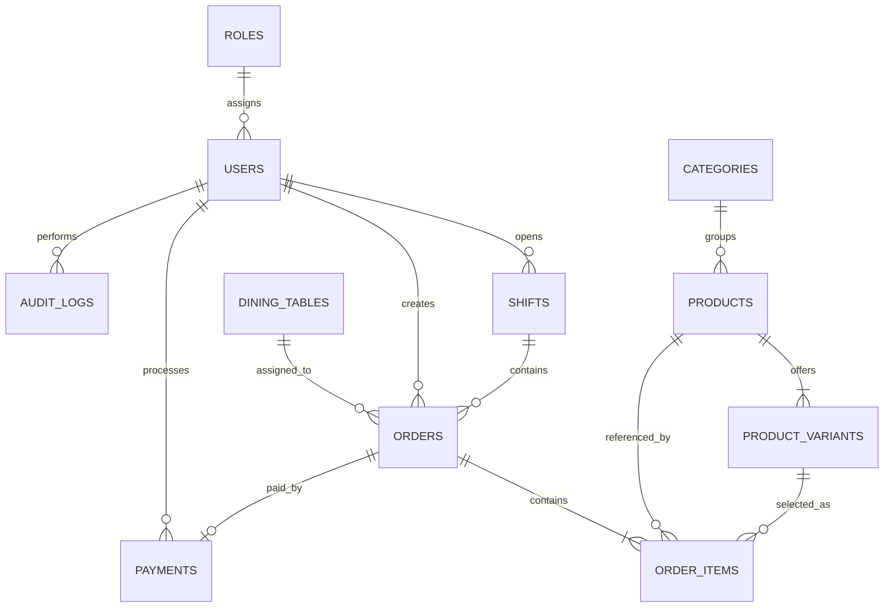

# Database Design — POS Rumah Makan Padang

**Database yang direkomendasikan:** MySQL 8+  
**Model:** Relational database  
**Catatan:** Ini rancangan konseptual awal. Sesuaikan tipe kolom dan syntax dengan versi database yang dipakai. Semua perubahan harus melalui migration.

## 1. Prinsip desain

- Database menjadi sumber kebenaran transaksi.
- Gunakan foreign key dan constraint.
- Nominal Rupiah disimpan sebagai integer `BIGINT` (satuan Rupiah) atau fixed precision yang konsisten; jangan gunakan FLOAT/DOUBLE.
- Semua tabel menggunakan primary key yang konsisten.
- Simpan timestamp UTC secara konsisten dan tampilkan ke `Asia/Jakarta`.
- Gunakan `created_at` dan `updated_at` sesuai kebutuhan.
- Jangan hard-delete data yang telah menjadi bagian histori transaksi.
- Snapshot item dan label meja harus disimpan agar histori tidak berubah karena master data.

## 2. Entitas dan kolom utama

### users

- `id`
- `name`
- `username` (unique)
- `email` (nullable, unique jika diisi)
- `password`
- `role_id`
- `is_active`
- `created_at`, `updated_at`

Gunakan fasilitas autentikasi Laravel dan jangan menyimpan password asli.

### roles

- `id`
- `name` (unique)
- `created_at`, `updated_at`

### permissions (opsional bila RBAC granular)

- `id`
- `name` (unique)
- `description`

### role_permissions (opsional bila RBAC granular)

- `role_id`
- `permission_id`
- unique pair (`role_id`, `permission_id`)

Untuk MVP, policy/gate Laravel dapat dimulai dengan tiga role, tetapi permission granular lebih mudah dikembangkan bila tindakan sensitif memerlukannya.

### categories

- `id`
- `name`
- `is_active`
- `sort_order`
- `created_at`, `updated_at`

Nama kategori sebaiknya unik sesuai kebijakan usaha.

### products

- `id`
- `category_id`
- `name`
- `description` nullable
- `unit` (contoh: potong, porsi, gelas)
- `image_path` nullable — path relatif pada disk `public`, bukan binary gambar dan bukan URL absolut
- `is_active`
- `is_available`
- `created_at`, `updated_at`
- `deleted_at` nullable bila menggunakan soft delete

Produk historis tidak dihapus permanen. Satu produk memiliki maksimal satu gambar utama. Variasi memakai gambar produk yang sama. File gambar tidak disimpan di database dan tidak dihapus saat produk hanya dinonaktifkan atau di-soft-delete.

### product_variants

- `id`
- `product_id`
- `name`
- `price` BIGINT UNSIGNED atau tipe nominal fixed precision
- `is_default`
- `is_active`
- `is_available`
- `created_at`, `updated_at`

Aturan:
- Satu produk minimal mempunyai satu variasi aktif/default untuk dijual.
- Variasi harus terkait dengan produk yang benar.
- Harga tidak boleh negatif.
- Jika produk mempunyai beberapa variasi aktif, kasir harus memilih variasi.

### dining_tables

- `id`
- `table_number` (unique dalam satu lokasi)
- `label` nullable
- `is_active`
- `created_at`, `updated_at`

Status meja diturunkan dari order aktif, bukan menjadi sumber data terpisah.

### shifts

- `id`
- `cashier_id` FK users
- `opening_cash` BIGINT
- `expected_cash` BIGINT nullable
- `actual_cash` BIGINT nullable
- `difference` BIGINT nullable
- `status` (`OPEN`, `CLOSED`)
- `opened_at`
- `closed_at` nullable
- `created_at`, `updated_at`

Jika satu shift aktif per kasir diwajibkan, enforce dalam service dengan lock/constraint yang sesuai.

Catatan implementasi Phase 5: tabel `shifts` dibuat oleh migration `2026_11_17_000008_create_shifts_table.php`. Aturan satu shift aktif per kasir saat ini dijamin oleh `ShiftService` dengan transaction + row lock pada `users` dan pengecekan status `OPEN`; bukan partial unique index karena tidak tersedia secara portabel di SQLite/MySQL pada level yang sama. `difference` bertanda tangan (bukan unsigned) agar selisih negatif dapat disimpan.

### orders

- `id`
- `order_number` (unique)
- `order_type` (`DINE_IN`, `TAKEAWAY`)
- `dining_table_id` nullable FK dining_tables
- `table_label_snapshot` nullable
- `cashier_id` FK users
- `shift_id` nullable FK shifts
- `status` (`OPEN`, `AWAITING_PAYMENT`, `PAID`, `VOIDED`)
- `subtotal` BIGINT
- `discount` BIGINT
- `tax` BIGINT
- `service_charge` BIGINT
- `total` BIGINT
- `notes` nullable
- `created_at`, `updated_at`
- `paid_at` nullable
- `voided_at` nullable
- `voided_by` nullable FK users
- `void_reason` nullable

Constraint/aturan:
- DINE_IN wajib memiliki `dining_table_id`.
- TAKEAWAY tidak memiliki `dining_table_id`.
- Total tidak boleh negatif.
- Order Paid tidak dapat diubah itemnya melalui alur biasa.
- `table_label_snapshot` mempertahankan label meja saat order dibuat.

Catatan implementasi Phase 3 dan Phase 5:
- Kolom `shift_id` ditambahkan pada Phase 5 oleh migration `2026_11_17_000009_add_shift_id_to_orders_table.php`, beserta index `orders(shift_id, status)` dan `orders(status, paid_at)`.
- Kolom `discount`, `tax`, `service_charge`, `paid_at`, `voided_at`, `voided_by`, dan `void_reason` sudah disiapkan sesuai rancangan ini, tetapi belum dipakai sebelum alur checkout/pembayaran diimplementasikan.
- Pembuatan order aktif menggunakan row lock pada `dining_tables` dan pengecekan status dalam satu transaction untuk mencegah dua order aktif pada meja yang sama.

### order_items

- `id`
- `order_id` FK orders
- `product_id` nullable FK products (dapat nullable untuk menjaga histori bila master dihapus melalui kebijakan tertentu)
- `product_variant_id` nullable FK product_variants
- `product_name_snapshot`
- `variant_name_snapshot`
- `unit_snapshot`
- `price_snapshot` BIGINT
- `quantity` DECIMAL atau integer sesuai kebijakan satuan; tentukan apakah item dapat dijual pecahan. Default MVP: integer positif.
- `subtotal` BIGINT
- `notes` nullable
- `created_at`, `updated_at`

Snapshot diperlukan agar nama/harga transaksi lama tidak berubah ketika master produk diperbarui.

### payments

- `id`
- `order_id` FK orders
- `payment_number` unique
- `idempotency_key` unique
- `payment_method` (`CASH`, `QRIS`, `TRANSFER`, `DEBIT`)
- `amount` BIGINT
- `received_amount` BIGINT nullable
- `change_amount` BIGINT default 0
- `status` (`PAID`, `FAILED`, `VOIDED` atau status lain sesuai implementasi)
- `processed_by` FK users
- `created_at`, `updated_at`

MVP menggunakan satu pembayaran penuh per order. Tambahkan unique constraint pada `order_id` bila kebijakan satu payment per order dikunci. Jika ada rencana multi-payment, jangan pasang constraint itu; implementasikan agregasi payment dan status order dengan benar.

Catatan implementasi Phase 4:
- Kebijakan satu payment per order dikunci, sehingga `order_id`, `payment_number`, dan `idempotency_key` memiliki unique constraint.
- `amount` dihitung backend dari `order_items` dan `orders.total`; browser tidak mengirim nominal final.
- `received_amount` dan `change_amount` hanya diisi untuk `CASH`; metode lain menyimpan `received_amount = null`.
- Payment, `orders.status = PAID`, dan `paid_at` ditulis dalam satu transaction dengan lock pada baris order.
- Receipt dibaca dari `order_items` snapshot dan payment tersimpan; cetak ulang tidak membuat payment.
- `business_settings` belum dibuat pada Phase 4, sehingga nama usaha di struk memakai `APP_NAME`.

### business_settings

Untuk MVP satu lokasi, simpan konfigurasi usaha dalam satu record atau struktur key/value tervalidasi:

- `id`
- `business_name`
- `address` nullable
- `phone` nullable
- `logo_path` nullable
- `receipt_footer` nullable
- `tax_enabled`
- `tax_configuration` (JSON/kolom terstruktur sesuai kebutuhan; jangan menyimpan formula bebas yang dieksekusi)
- `service_charge_enabled`
- `service_charge_configuration`
- `created_at`, `updated_at`

Batasi perubahan konfigurasi finansial berdasarkan permission dan audit. Jangan mengaktifkan pajak/biaya layanan tanpa keputusan pemilik.

### audit_logs

- `id`
- `user_id` nullable FK users
- `action`
- `entity_type`
- `entity_id` nullable
- `description` atau metadata JSON yang aman
- `ip_address` nullable sesuai kebijakan privasi
- `created_at`

Jangan simpan password, token, atau rahasia lain di audit log.

## 3. Relasi utama

Diagram menunjukkan relasi konseptual. FK pada histori item boleh memakai strategi penghapusan/nullable yang menjaga snapshot, bukan cascade delete dari master ke order item.

## 4. Indeks yang disarankan

- `users.username` unique.
- `users.email` unique jika digunakan.
- `products(category_id, is_active, is_available)` untuk katalog.
- `product_variants(product_id, is_active, is_available)`.
- `dining_tables.table_number` unique.
- `orders.order_number` unique.
- `orders(status, created_at)`.
- `orders(status, paid_at)` untuk laporan.
- `orders(cashier_id, created_at)`.
- `orders(shift_id, status)`.
- `order_items(order_id)`.
- `order_items(product_id, product_variant_id)`.
- `payments(order_id)`.
- `payments(idempotency_key)` unique.
- `audit_logs(entity_type, entity_id, created_at)`.

Tinjau query aktual dengan EXPLAIN sebelum menambah indeks secara berlebihan.

## 5. Concurrency dan satu order aktif per meja

MySQL tidak otomatis menyelesaikan aturan satu order aktif per meja dengan unique index sederhana karena keunikan hanya berlaku pada subset status aktif.

Pola implementasi yang disarankan:
1. Mulai database transaction.
2. Ambil row `dining_tables` dengan `SELECT ... FOR UPDATE` melalui ORM/DB layer.
3. Validasi meja aktif.
4. Periksa apakah ada order status `OPEN` atau `AWAITING_PAYMENT` untuk meja tersebut.
5. Jika ada, tolak atau arahkan kasir membuka order yang sudah ada.
6. Jika tidak ada, buat order aktif.
7. Commit.

Semua endpoint yang dapat membuat, memindahkan (bila kelak ada), membayar, atau membatalkan order harus mengikuti strategi lock yang konsisten. Tambahkan test concurrency/integration sejauh memungkinkan.

## 6. Atomic payment flow

1. Mulai transaction.
2. Lock row order.
3. Periksa status order masih dapat dibayar.
4. Ambil ulang item dan harga snapshot dari database.
5. Hitung ulang subtotal/biaya/total di backend.
6. Validasi metode dan nominal.
7. Periksa idempotency key.
8. Buat payment.
9. Update order menjadi `PAID` dan isi `paid_at`.
10. Commit.

Jika salah satu langkah gagal, rollback seluruh perubahan. Request ulang dengan idempotency key yang sama harus mengembalikan hasil sebelumnya atau respons aman tanpa membuat payment kedua.

## 7. Laporan dan perhitungan

- Omzet berdasarkan order `PAID` dan `paid_at`.
- Item terlaris dihitung dari `order_items` milik order Paid.
- Metode pembayaran berasal dari payment berhasil.
- Batas tanggal laporan dihitung dalam `Asia/Jakarta` lalu dikonversi konsisten ke timezone penyimpanan (`config('app.timezone')`, saat ini `Asia/Jakarta`). `ResolveDateRange` melakukan konversi ini agar query tetap benar bila konfigurasi timezone aplikasi berubah.
- Open/Awaiting Payment/Voided tidak dihitung omzet.

Catatan implementasi Phase 5: laporan dan export CSV tidak menambah tabel agregat. Angka dihitung dari `orders`, `payments`, `order_items`, dan `shifts` pada saat request. Riwayat memakai filter `view=active|history`; `history` hanya menampilkan `PAID` dan `VOIDED`, sedangkan `active` menampilkan `OPEN` dan `AWAITING_PAYMENT`.

## 8. Hal yang belum dikunci

- Apakah item boleh mempunyai quantity pecahan (misalnya setengah porsi)? Default: tidak.
- Apakah satu order boleh memakai lebih dari satu payment method? Default: tidak.
- Apakah order Paid dapat direfund pada MVP? Default: belum; koreksi harus terotorisasi dan diaudit.
- Apakah perlu tabel `order_events` terpisah untuk riwayat perubahan status? Direkomendasikan jika audit order perlu lebih rinci daripada `audit_logs` umum.
- Apakah aplikasi hanya satu lokasi? Default: ya. Multi-cabang memerlukan `business_locations` dan relasi data yang lebih luas.
