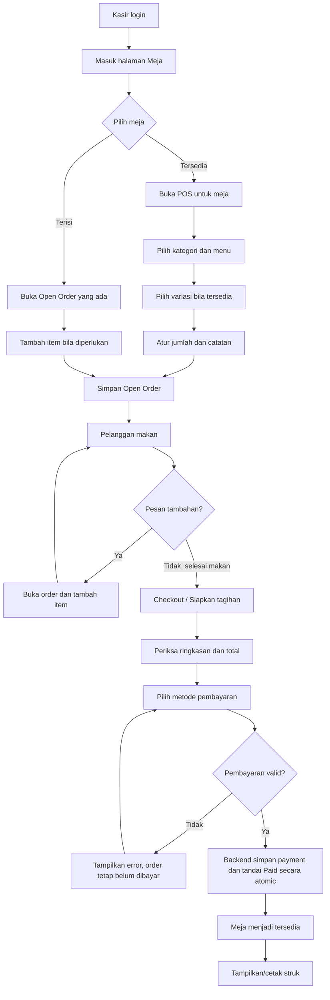
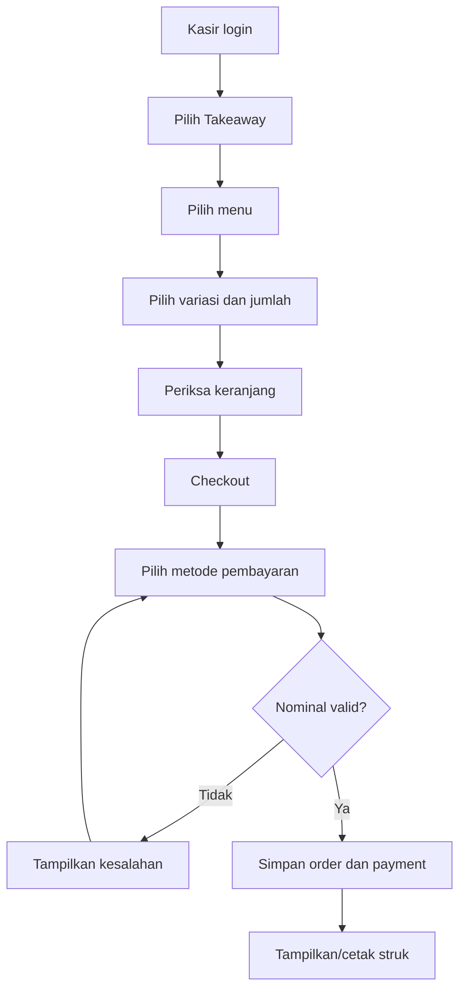
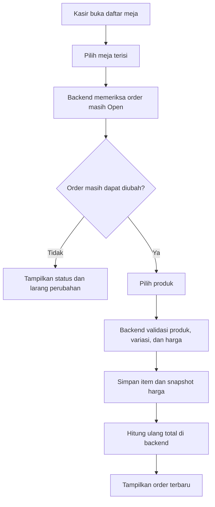
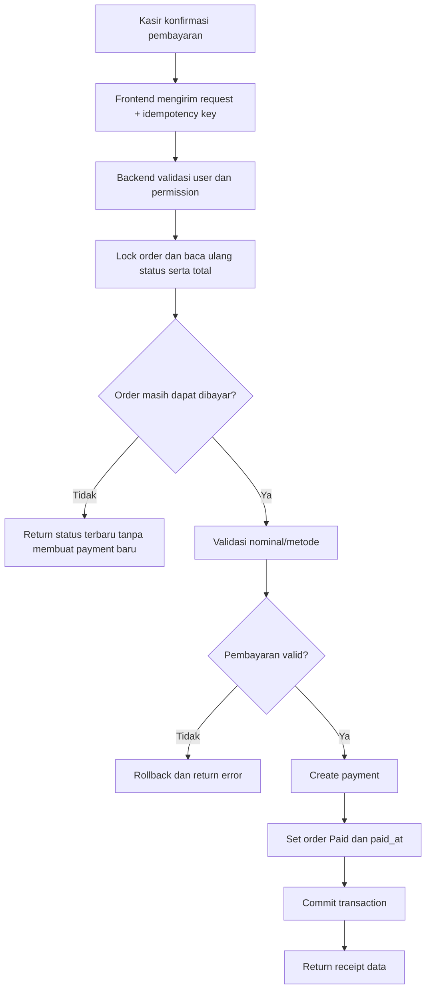
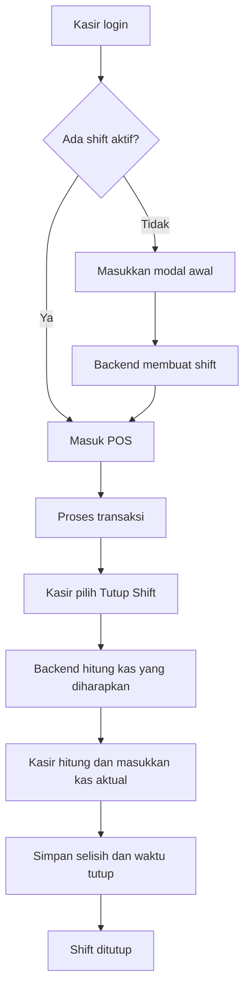

# User Flows — POS Rumah Makan Padang

Dokumen ini mendeskripsikan urutan interaksi utama. Diagram menggunakan Mermaid dan dapat dirender di editor Markdown yang mendukung Mermaid.

## 1. Dine-in: buat Open Order sampai pembayaran

## 2. Takeaway

Default MVP adalah takeaway langsung checkout. Jika rumah makan perlu menyimpan takeaway belum dibayar atau menunggu dibuat, validasi dan ubah flow sebelum implementasi.

Implementasi Phase 5: saat tombol checkout takeaway ditekan, backend membuat order bertipe `TAKEAWAY` tanpa `dining_table_id`, menyimpan snapshot item, lalu mengarahkan ke halaman checkout yang sama dengan dine-in. Pembayaran penuh dibuat sekali di endpoint `orders.pay`.

## 3. Tambah item pada Open Order

## 4. Pembayaran dan idempotency

## 5. Buka dan tutup shift

Implementasi Phase 5: shift aktif tidak diwajibkan, tetapi bila ada, order yang dibuat kasir tersebut otomatis mendapat `shift_id`. Expected cash = modal awal + total pembayaran tunai bersih pada shift; non-tunai tidak masuk kas fisik. Kasir hanya dapat menutup shift miliknya; admin/owner dengan `manage-shifts` dapat menutup shift siapa pun.

## 6. Role dan akses halaman

| Area | Kasir | Admin | Owner |
|---|---:|---:|---:|
| POS dan Open Order | Ya | Ya | Sesuai kebutuhan |
| Meja | Lihat/pakai | Kelola | Lihat/kelola sesuai permission |
| Produk dan variasi | Lihat | Kelola | Kelola bila diizinkan |
| Riwayat transaksi | Ya (semua order) | Ya | Ya |
| Laporan | Tidak (403 dari server) | Ya | Ya |
| User management | Tidak | Ya | Ya |
| Pengaturan usaha | Tidak | Ya | Ya |
| Void/correction Paid | Tidak | Dengan permission | Dengan permission |

Authorization sebenarnya harus diperiksa backend; tabel ini bukan pengganti policy/gate.

## 7. Error dan kondisi khusus yang harus didesain

- Meja telah diambil kasir lain sebelum request tersimpan.
- Produk/variasi habis setelah halaman POS dibuka.
- Harga berubah ketika kasir masih membuka katalog.
- Order telah dibayar dari sesi lain.
- Request pembayaran terkirim dua kali.
- Browser refresh ketika menyimpan order.
- Jaringan terputus ketika checkout.
- Shift ditutup sebelum transaksi baru dibuat.
- Produk dinonaktifkan saat masih ada di Open Order.
- Printer tidak terhubung atau gagal mencetak.

Pada semua kondisi tersebut, tampilkan status yang jelas dan jangan membuat data transaksi ganda atau setengah tersimpan.

## 8. Kelola foto produk

1. Admin/Owner membuka halaman tambah atau edit produk.
2. Pilih berkas JPG, PNG, atau WebP maksimal 5 MB; pratinjau muncul sebelum submit.
3. Simpan produk. Backend memvalidasi ulang MIME dari konten berkas, ukuran, dan dimensi.
4. Pada edit, memilih berkas baru mengganti foto lama; tombol “Hapus foto” menghapus foto dan mengosongkan `image_path`.
5. File lama hanya dihapus setelah transaksi database berhasil. Jika upload gagal, foto lama tetap terpasang.
6. Kasir melihat foto pada kartu katalog, detail Open Order, dan keranjang takeaway; foto tidak mengubah snapshot transaksi.
